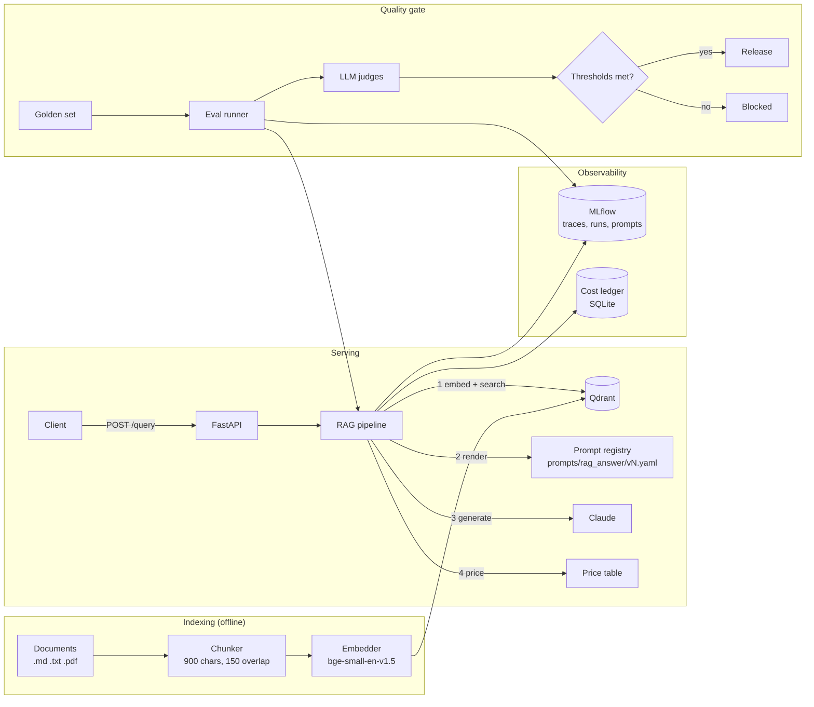
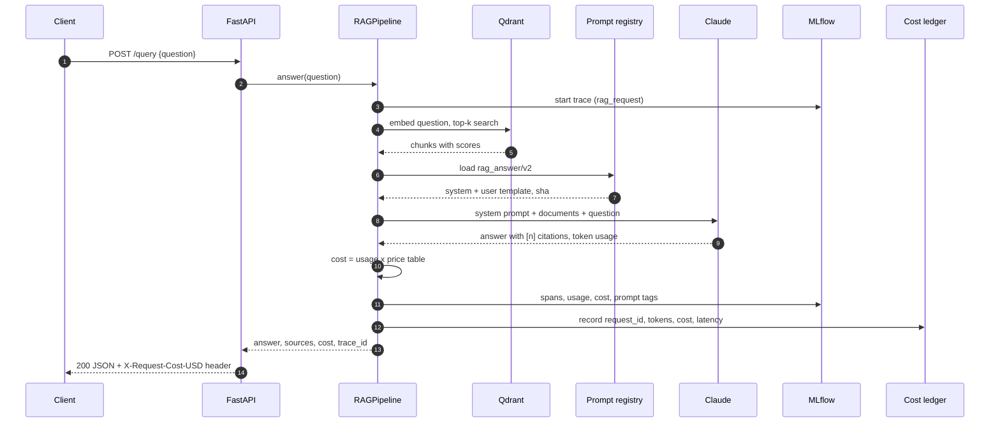
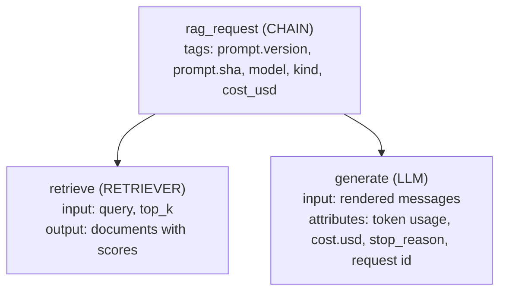
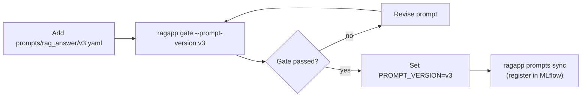
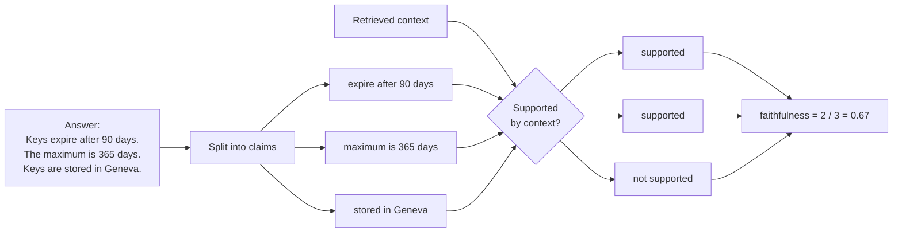
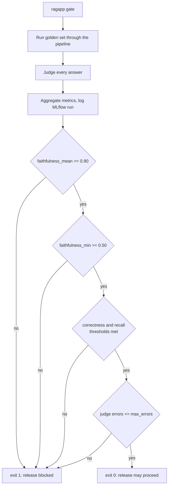
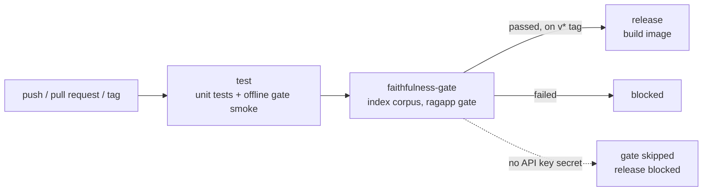

# LLMOps Capstone: Production RAG with Tracing, Evaluation and a Faithfulness Release Gate


A retrieval-augmented generation (RAG) service that answers questions from a document
corpus, built with the operational layer a production LLM app needs: every request is
traced, costed and tied to a prompt version, and a release cannot ship unless an automated
evaluation shows the answers are faithful to the retrieved sources.

## Contents

- [What it does](#what-it-does)
- [Architecture](#architecture)
- [How a request flows](#how-a-request-flows)
- [Quick start](#quick-start)
- [Using the API](#using-the-api)
- [Tracing](#tracing)
- [Prompt versioning](#prompt-versioning)
- [Cost tracking](#cost-tracking)
- [Evaluation](#evaluation)
- [The release gate](#the-release-gate)
- [CI pipeline](#ci-pipeline)
- [Offline mode](#offline-mode)
- [Docker](#docker)
- [Configuration](#configuration)
- [Project layout](#project-layout)
- [Further reading](#further-reading)

## What it does

| Capability | How it is implemented | Code |
|---|---|---|
| RAG on a vector database | Qdrant (server via Docker, or embedded on-disk mode) with local FastEmbed embeddings | [`vectorstore.py`](src/ragapp/vectorstore.py), [`ingest.py`](src/ragapp/ingest.py), [`embeddings.py`](src/ragapp/embeddings.py) |
| MLflow tracing | One trace per request with `rag_request` > `retrieve` > `generate` spans, token usage, cost and prompt-version tags | [`pipeline.py`](src/ragapp/pipeline.py), [`tracing.py`](src/ragapp/tracing.py) |
| Automated evaluation | Claude LLM judges with schema-constrained output score faithfulness, answer correctness and context recall over a golden set | [`evaluation/`](src/ragapp/evaluation) |
| Prompt versioning | Prompts are YAML files, content-hashed, tagged on every trace and eval run, mirrored to the MLflow Prompt Registry | [`prompts.py`](src/ragapp/prompts.py), [`prompts/`](prompts) |
| Per-request cost tracking | Token usage x price table, returned in the response and headers, stored in a SQLite ledger | [`cost.py`](src/ragapp/cost.py), [`config/pricing.yaml`](config/pricing.yaml) |
| Release gate on faithfulness | `ragapp gate` exits 1 unless thresholds are met; the CI release job depends on it | [`evaluation/gate.py`](src/ragapp/evaluation/gate.py), [`config/gate.yaml`](config/gate.yaml) |

## Architecture



The serving path and the evaluation path use the same `RAGPipeline` object, so the thing
that is evaluated is exactly the thing that serves traffic.

## How a request flows



1. **Retrieve.** The question is embedded and the `top_k` nearest chunks are fetched from Qdrant by cosine similarity.
2. **Render.** The active prompt version wraps each chunk in a numbered `<document>` tag and appends the question.
3. **Generate.** Claude answers using only those documents and cites them as `[1]`, `[2]`. If the documents do not cover the question, it says so.
4. **Account.** Token usage is priced by the model that actually served the request, and written to the trace and the ledger.

## Quick start

Requires Python 3.10 or newer and an Anthropic API key.

```bash
git clone https://github.com/SAMSAROHA/llmops-rag-capstone.git
```

```bash
cd llmops-rag-capstone
```

```bash
python -m venv .venv
```

Windows:

```bash
.venv\Scripts\activate
```

macOS / Linux:

```bash
source .venv/bin/activate
```

```bash
pip install -e ".[dev]"
```

Copy `.env.example` to `.env` and set `ANTHROPIC_API_KEY`, then index the sample corpus
(a fictional "Aurora Cloud" handbook in [`data/docs`](data/docs)). The first run downloads
the embedding model.

```bash
ragapp ingest --recreate
```

Ask a question:

```bash
ragapp ask "If uptime for a month was 98%, what service credit do I get?"
```

Run the release gate:

```bash
ragapp gate
```

### All commands

| Command | Purpose |
|---|---|
| `ragapp ingest [path] [--recreate]` | Chunk and index a file or folder of `.md`, `.txt`, `.pdf` |
| `ragapp ask "question" [--prompt-version v1] [--json]` | Answer one question |
| `ragapp serve [--host] [--port]` | Start the HTTP API |
| `ragapp eval [--prompt-version]` | Score the golden set and log to MLflow |
| `ragapp gate [--prompt-version] [--gate-file]` | Same, then enforce thresholds (exit 1 on failure) |
| `ragapp prompts list` / `ragapp prompts sync` | Show prompt versions / register them in MLflow |
| `ragapp costs` | Print the cost ledger summary |

## Using the API

```bash
ragapp serve
```

```bash
curl -X POST http://127.0.0.1:8000/query -H "Content-Type: application/json" -d "{\"question\": \"How much does data egress cost?\"}"
```

Response shape (values are illustrative):

```json
{
  "request_id": "3f2a9c0e5d1b4a7e8c6f0b2d4e6a8c1f",
  "answer": "Data egress is free for the first 100 GB each month and $0.07 per GB after that [1].",
  "sources": [
    {"index": 1, "source": "pricing.md", "score": 0.83, "text": "..."}
  ],
  "prompt": {"name": "rag_answer", "version": "v2", "sha": "26796a140337"},
  "model": "claude-opus-5-5",
  "usage": {"input_tokens": 1450, "output_tokens": 120, "cache_read_input_tokens": 0, "cache_creation_input_tokens": 0},
  "cost": {"input_usd": 0.0058, "output_usd": 0.0024, "cache_usd": 0.0, "priced": true, "total_usd": 0.0082},
  "latency_ms": 2140.5,
  "stop_reason": "end_turn",
  "trace_id": "tr-..."
}
```

| Endpoint | Description |
|---|---|
| `POST /query` | Answer a question. Body: `question`, optional `top_k`, optional `prompt_version` |
| `GET /health` | Index size, model and active prompt |
| `GET /costs` | Spend grouped by model, prompt version and kind |
| `GET /costs/{request_id}` | Ledger row for one request |

Response headers: `X-Request-Id`, `X-Request-Cost-USD`, `X-Prompt-Version`.
Interactive docs are served at `/docs`.

## Tracing

Every request produces one MLflow trace:



Open the UI to browse traces, filter by prompt version, and inspect the exact documents
and prompt that produced an answer:

```bash
mlflow ui --backend-store-uri sqlite:///mlflow.db
```

The `trace_id` in each API response and each cost-ledger row links back to its trace.

## Prompt versioning

Prompts are files, reviewed in git like code:

```
prompts/rag_answer/
  v1.yaml   baseline: answer from the documents
  v2.yaml   grounded answers, [n] citations, explicit abstention   (active)
```

Each version gets a content hash. The version and hash are attached to every trace, every
ledger row and every evaluation run, so any score or any dollar can be traced to the exact
prompt text that produced it.



## Cost tracking

```
cost = input_tokens       x input price
     + output_tokens      x output price
     + cache_read_tokens  x cache-read price
     + cache_write_tokens x cache-write price        (all per million tokens)
```

Prices live in [`config/pricing.yaml`](config/pricing.yaml). The cost of each request is:

- returned in the response body (`cost`) and the `X-Request-Cost-USD` header,
- attached to the MLflow trace,
- stored in a SQLite ledger with tokens, latency, model, prompt version and trace id.

A model missing from the price table is recorded as `priced: false` with zero cost
instead of a guess. Evaluation traffic is tagged `kind=eval` and kept out of the production ledger.

## Evaluation

`ragapp eval` runs every question in [`data/eval/golden.jsonl`](data/eval/golden.jsonl)
through the real pipeline and scores each answer with three LLM-judge metrics, each from 0 to 1:

| Metric | Question it answers | How it is computed |
|---|---|---|
| **Faithfulness** | Is the answer supported by what was retrieved? | Judge splits the answer into atomic claims and verifies each against the context. Score = supported claims / total claims. |
| **Answer correctness** | Does the answer agree with the expert reference? | Judge grades agreement 1-5, rescaled to 0-1. For unanswerable questions the correct behaviour is to decline. |
| **Context recall** | Did retrieval find the needed information? | Judge splits the reference answer into statements and checks each against the context. Isolates the retriever from the generator. |

How faithfulness is scored for one answer:



Which metric points at which component:

| Symptom | Likely cause | Fix |
|---|---|---|
| Low context recall | Retriever missed the passage | Chunking, `top_k`, embedding model |
| High recall, low faithfulness | Generator invented or over-extended | Prompt |
| High faithfulness, low correctness | Grounded in the wrong passage | Retrieval ranking |

Results are written to `reports/eval_report.{json,md}` and logged as an MLflow run with
the prompt version, model, per-sample table and aggregate metrics.

## The release gate

`ragapp gate` runs the evaluation and compares the aggregates with
[`config/gate.yaml`](config/gate.yaml):

```yaml
thresholds:
  faithfulness_mean: 0.90      # headline gate
  faithfulness_min: 0.50       # no single answer may be mostly unsupported
  answer_correctness_mean: 0.70
  context_recall_mean: 0.70
max_errors: 0
```



Rules that keep the gate honest:

- A metric that could not be computed never passes.
- Samples where the judge call failed count as errors, and `max_errors` is 0.
- The MLflow run is tagged `gate=passed` or `gate=failed` for audit.

## CI pipeline

[`.github/workflows/release-gate.yml`](.github/workflows/release-gate.yml):



To enable the gate job, add `ANTHROPIC_API_KEY` under the repository's
Settings > Secrets and variables > Actions.

## Offline mode

For development without an API key or network:

| Setting | Effect |
|---|---|
| `LLM_PROVIDER=fake` | Replaces Claude with a lexical extractive stand-in, and the LLM judge with a token-overlap heuristic |
| `EMBEDDING_PROVIDER=hash` | Replaces FastEmbed with a hashing embedder |

The unit tests run this way. It verifies the wiring, including that a hallucinating
generator fails the gate. It is not a quality signal: pair it with
[`config/gate.offline.yaml`](config/gate.offline.yaml), and gate real releases with Claude.

```bash
pytest
```

## Docker

```bash
docker compose up --build
```

starts Qdrant (port 6333), an MLflow server (5000) and the API (8000). Then index the corpus:

```bash
docker compose exec api ragapp ingest --recreate
```

## Configuration

Every setting can be supplied as an environment variable or in `.env`.

| Variable | Default | Meaning |
|---|---|---|
| `ANTHROPIC_API_KEY` | none | Credentials for Claude |
| `LLM_PROVIDER` | `anthropic` | `anthropic` or `fake` |
| `LLM_MODEL` | `claude-opus-5-5` | Generation model |
| `LLM_EFFORT` | `medium` | Reasoning effort: `low` to `max` |
| `JUDGE_MODEL` | `claude-opus-5-5` | Evaluation judge model |
| `LLM_REFUSAL_FALLBACK` | `true` | Retry safety declines on a fallback model in the same call |
| `EMBEDDING_PROVIDER` | `fastembed` | `fastembed` or `hash` |
| `EMBEDDING_MODEL` | `BAAI/bge-small-en-v1.5` | FastEmbed model |
| `QDRANT_URL` | unset | Qdrant server URL; unset uses embedded mode at `QDRANT_PATH` |
| `TOP_K` | `4` | Chunks retrieved per question |
| `CHUNK_CHARS` / `CHUNK_OVERLAP` | `900` / `150` | Chunking parameters |
| `PROMPT_VERSION` | `v2` | Active prompt version (`latest` also works) |
| `MLFLOW_TRACKING_URI` | `sqlite:///mlflow.db` | MLflow backend |
| `TRACING_ENABLED` | `true` | Turn tracing on or off |

Embedded Qdrant allows one process at a time: stop `ragapp serve` before running
`ragapp eval`, or use the Qdrant server.

## Project layout

```
src/ragapp/
  config.py        settings (env / .env)
  embeddings.py    FastEmbed + offline hash embedder
  vectorstore.py   Qdrant wrapper
  ingest.py        load, chunk, index
  prompts.py       file-backed prompt registry + MLflow sync
  llm.py           Claude client + offline fake
  cost.py          price table + SQLite ledger
  pipeline.py      the traced request path
  api.py           FastAPI service
  cli.py           ragapp command
  evaluation/
    judges.py      LLM judge + heuristic judge
    runner.py      golden-set runner, report, MLflow logging
    gate.py        threshold checks
prompts/           versioned prompts
config/            pricing and gate thresholds
data/docs          sample corpus
data/eval          golden set
tests/             offline test suite
docs/              architecture and evaluation guides
```

## Further reading

- [docs/ARCHITECTURE.md](docs/ARCHITECTURE.md): components, data model and design decisions
- [docs/EVALUATION.md](docs/EVALUATION.md): metrics, judge prompts, golden set format and tuning the gate

## License

MIT. See [LICENSE](LICENSE).
