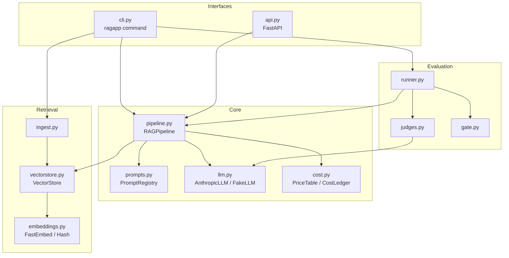
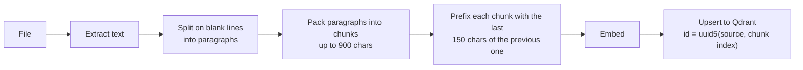
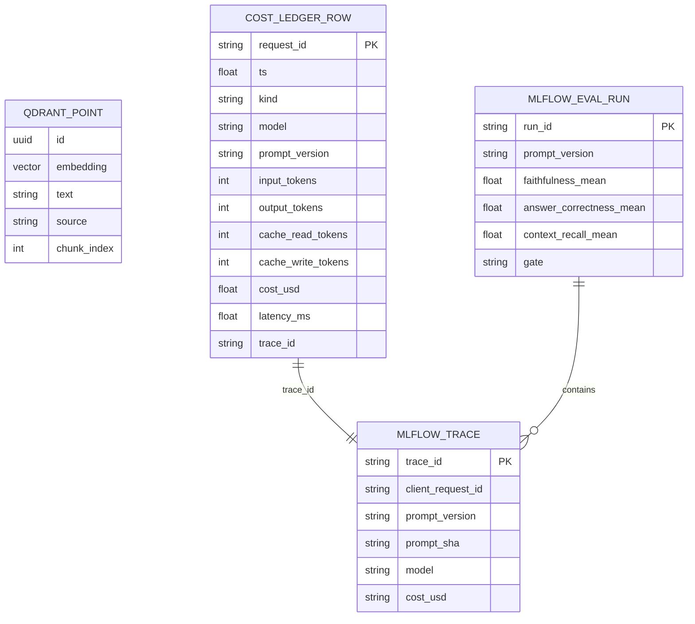

# Architecture

This document explains how the system is put together and why.

## Components



| Module | Responsibility |
|---|---|
| `config.py` | One `Settings` object read from environment variables or `.env` |
| `embeddings.py` | Turns text into vectors. FastEmbed for real use, a hashing embedder for offline runs |
| `vectorstore.py` | Creates the Qdrant collection, upserts chunks, runs similarity search |
| `ingest.py` | Reads `.md` / `.txt` / `.pdf`, splits into overlapping chunks, indexes them |
| `prompts.py` | Loads versioned prompt files, hashes them, renders them, syncs them to MLflow |
| `llm.py` | Calls Claude and normalises the result into text + token usage |
| `cost.py` | Converts usage into dollars and persists one row per request |
| `pipeline.py` | Orchestrates retrieve, render, generate, cost, and emits the trace |
| `api.py` / `cli.py` | HTTP and command-line front ends over the same pipeline |
| `evaluation/` | Golden-set runner, judges and the release gate |

## Indexing



- **Paragraph-aware chunking** keeps related sentences together. Paragraphs longer than the
  limit are split on sentence boundaries.
- **Overlap** means a fact that straddles a chunk boundary is still retrievable whole.
- **Deterministic ids** make ingestion idempotent: re-ingesting a file overwrites its
  chunks instead of duplicating them.

Each point in Qdrant stores:

| Field | Content |
|---|---|
| `id` | UUID derived from source path and chunk index |
| `vector` | 384-dimension embedding, cosine distance |
| `payload.text` | The chunk text |
| `payload.source` | Relative file path |
| `payload.chunk_index` | Position of the chunk in the file |

## Serving

`RAGPipeline.answer()` is the single request path. It opens a root MLflow span and inside it:

1. `_retrieve` embeds the question and queries Qdrant (span type `RETRIEVER`).
2. The prompt registry returns the active `PromptVersion`, which renders the system
   prompt and a user message containing numbered `<document>` blocks and the question.
3. `_generate` calls the LLM (span type `LLM`), records token usage and cost on the span.
4. The trace is tagged with prompt name, version, hash, model, kind and cost.
5. The request is written to the cost ledger.

The response object carries everything a caller or auditor needs: answer, sources,
prompt identity, model, usage, cost, latency, stop reason and trace id.

### Prompt layout

Documents come first and the question last. Each chunk is wrapped as:

```xml
<document index="1" source="pricing.md">
...chunk text...
</document>
```

The system prompt (v2) explains why grounding matters, asks for `[n]` citations after
each factual statement, and tells the model to say so when the documents do not cover the
question. It also states that document text is reference material, not instructions,
which limits prompt injection through indexed content.

## Data stores



## Design decisions

**Qdrant with two modes.** The same client code talks to a Qdrant server (Docker,
production) or an embedded on-disk store (local development, CI), so no service is
needed to try the project.

**Local embeddings.** FastEmbed runs `bge-small-en-v1.5` in-process with ONNX. Indexing and
querying need no embedding API, cost nothing per token, and stay reproducible.

**Prompts as files, not database rows.** A prompt change goes through the same pull
request, review and CI gate as a code change. The content hash catches edits to a file
that kept its version name.

**Custom LLM judges instead of a metrics library.** The judges implement the standard
claim-decomposition definition of faithfulness directly with schema-constrained output.
The scoring logic is about 200 lines, fully visible, and each verdict comes with the
judge's reason, which makes failures debuggable.

**One pipeline for serving and evaluation.** The eval runner calls the same
`RAGPipeline.answer()` as the API. There is no separate "eval version" of the logic that
could drift.

**Cost priced by the serving model.** With refusal fallback enabled, a different model
may serve a request. Cost uses the model reported in the response, not the one requested.

**Fail closed.** Unknown models are marked unpriced, uncomputable metrics fail the gate,
judge failures count as errors, and a skipped gate blocks the release job.

**Offline stand-ins.** `FakeLLM`, `HeuristicJudge` and `HashEmbedder` let the full flow run
in unit tests without network or keys. They exist to test wiring, not quality.

## Extending

| To change | Edit |
|---|---|
| The corpus | Run `ragapp ingest <folder>` and write a matching golden set |
| The embedding model | `EMBEDDING_MODEL`, then `ragapp ingest --recreate` |
| The prompt | Add `prompts/rag_answer/vN.yaml`, gate it, set `PROMPT_VERSION` |
| The thresholds | `config/gate.yaml` |
| The prices | `config/pricing.yaml` |
| The vector database | Implement the three methods of `VectorStore` for another backend |
