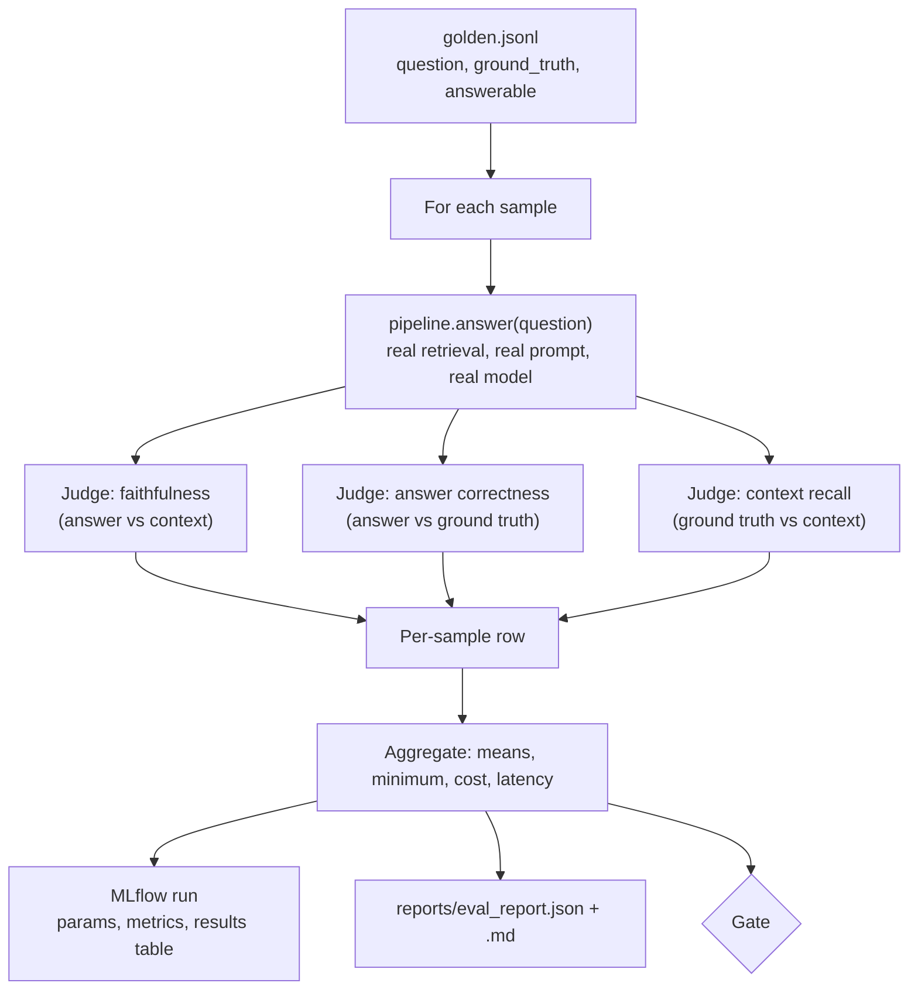
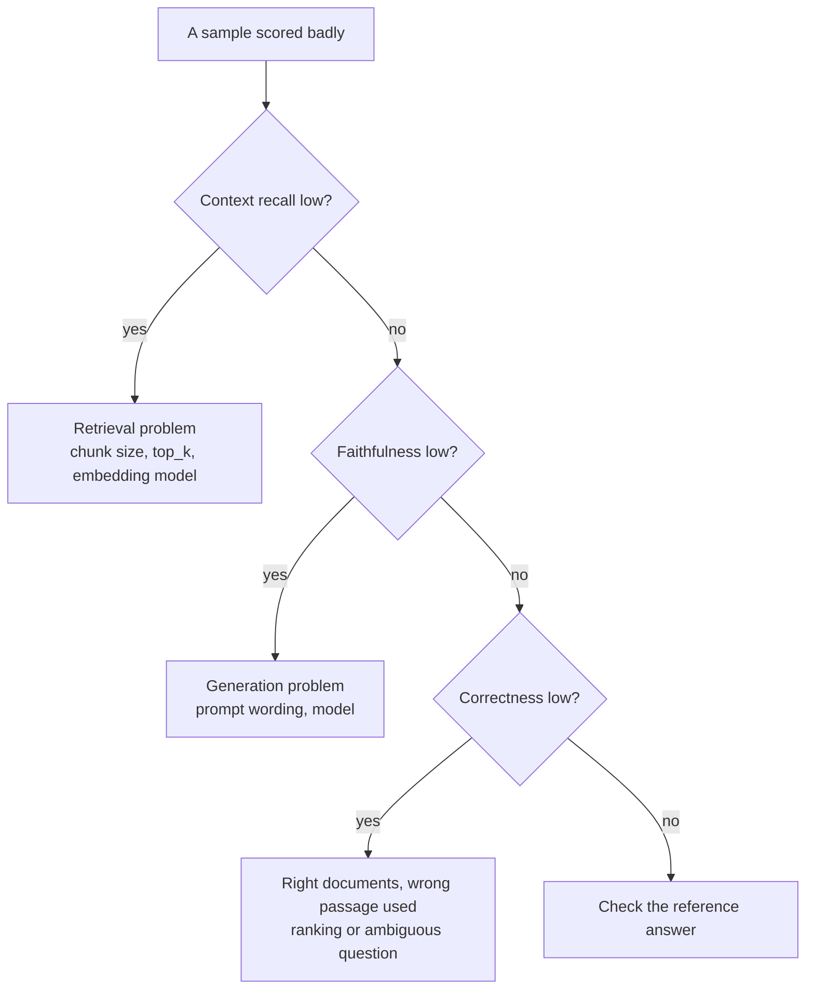

# Evaluation and the Release Gate

## Why gate on faithfulness

A RAG system fails in a specific, dangerous way: it gives a fluent answer that the
retrieved documents do not support. Users cannot tell such an answer from a grounded one.
Faithfulness measures exactly this, and it can be checked without knowing the right
answer in advance, because it only compares the answer with the context it was given.

The gate turns that measurement into a rule: a change to the prompt, the model, the
chunking or the retriever cannot be released if it makes answers less grounded.

## The evaluation loop



## The golden set

One JSON object per line in `data/eval/golden.jsonl`:

```json
{"id": "pricing-egress", "question": "How much does data egress cost?", "ground_truth": "Data egress is free for the first 100 GB each month and costs $0.07 per GB after that.", "answerable": true}
```

| Field | Meaning |
|---|---|
| `id` | Stable identifier shown in reports |
| `question` | What a user would ask |
| `ground_truth` | The reference answer, written from the source documents |
| `answerable` | `false` when the corpus does not contain the answer |

The shipped set has 15 samples: 13 answerable questions across all five documents and 2
unanswerable ones. Unanswerable samples test abstention: the correct output is to say the
documentation does not cover the question.

Guidelines for extending it:

- Write questions the way users ask, not the way the document is phrased.
- Include questions that need a rule applied to a case ("uptime was 98%, what credit?").
- Keep some unanswerable questions that sound plausible for the domain.
- Add a sample for every production failure you find.

## Metrics

### Faithfulness

The judge receives the retrieved context, the question and the answer. It:

1. splits the answer into atomic factual claims, skipping citation markers and
   non-factual sentences such as "the documents do not cover this";
2. decides for each claim whether the context states it or it follows directly from the
   context, including simple arithmetic or applying a stated rule.

```
faithfulness = supported claims / total claims
```

A claim that is true in the real world but absent from the context counts as unsupported.
An answer with no factual claims, such as a clean abstention, scores 1.0.

### Answer correctness

The judge compares the answer with the reference on a 1-5 rubric:

| Score | Meaning |
|---|---|
| 5 | Everything in the reference, nothing incorrect added |
| 4 | Key facts present, minor omissions or harmless extra detail |
| 3 | Partly correct |
| 2 | Mostly wrong, small correct element |
| 1 | Contradicts the reference or does not answer |

Rescaled to 0-1 as `(score - 1) / 4`. For unanswerable samples, declining scores 5 and
supplying facts anyway scores 1.

### Context recall

The judge splits the reference answer into statements and checks whether the retrieved
context contains each one.

```
context_recall = reference statements found in context / total reference statements
```

This measures the retriever alone. It is not computed for unanswerable samples.

## Reading the results



The report lists unsupported claims per sample, and each row carries a `trace_id`, so a
bad score leads straight to the documents and prompt that produced it.

## The judges

`LLMJudge` makes up to three calls per sample using schema-constrained output, so every
response parses into a typed object:

| Call | Output schema |
|---|---|
| Faithfulness | list of `{claim, reason, supported}` |
| Correctness | `{reasoning, score}` |
| Context recall | list of `{statement, reason, in_context}` |

Each schema asks for the reason before the verdict, which makes the judge justify a
decision before committing to it and leaves an explanation in the report.

`HeuristicJudge` approximates the same three metrics with token overlap for offline
tests. It cannot detect paraphrased or subtly wrong claims.

## Gate thresholds

`config/gate.yaml`:

| Check | Default | Purpose |
|---|---|---|
| `faithfulness_mean` | 0.90 | Headline quality bar |
| `faithfulness_min` | 0.50 | Stops one badly hallucinated answer hiding behind a good average |
| `answer_correctness_mean` | 0.70 | Guards against grounded but wrong or unhelpful answers |
| `context_recall_mean` | 0.70 | Guards against retrieval regressions |
| `max_errors` | 0 | Samples whose evaluation failed |

Setting thresholds: run `ragapp eval` on the current production configuration several
times, note the spread of each metric, and set each threshold slightly below the lowest
observed value. Tighten as the system improves.

## Comparing configurations

Every eval run is an MLflow run with the prompt version, prompt hash, model, judge,
embedder and `top_k` as parameters. To compare two prompts:

```bash
ragapp eval --prompt-version v1
```

```bash
ragapp eval --prompt-version v2
```

Then select both runs in the MLflow UI and compare metrics side by side.

## Cost of evaluation

Each sample costs one generation call and up to three judge calls. The report shows
generation cost and judge cost separately. To reduce it, set `JUDGE_MODEL` to a smaller
model, after checking on a sample that its verdicts agree with the larger judge.

## Limits

- LLM judges are not perfectly consistent. Scores can move slightly between runs, which
  is why thresholds should sit below the observed range rather than at it.
- A golden set only covers what is in it. Passing the gate means no regression on known
  cases, not correctness everywhere.
- Using the same model family to generate and to judge can bias scores upward. A
  different judge model reduces this.
